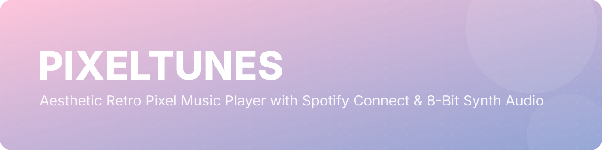
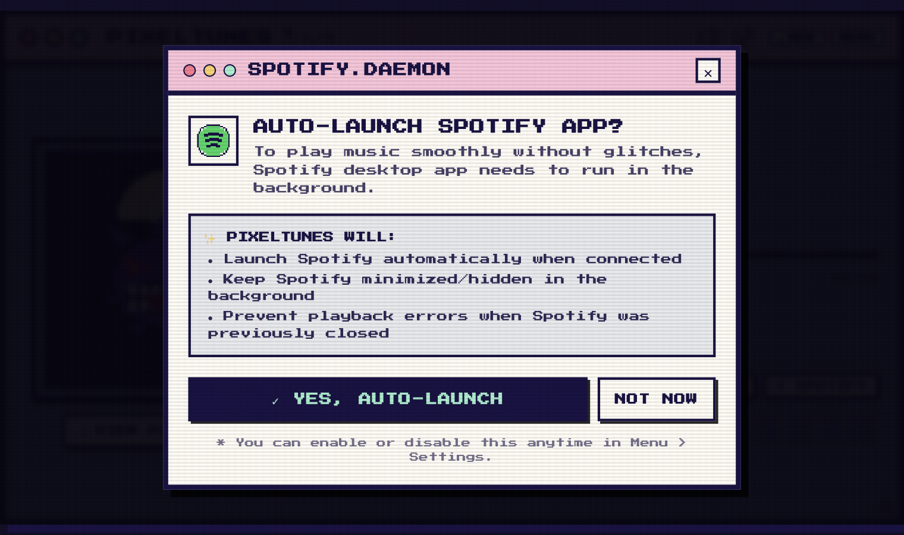
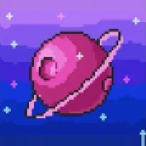
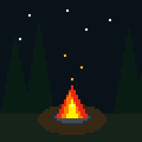
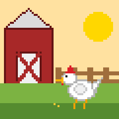
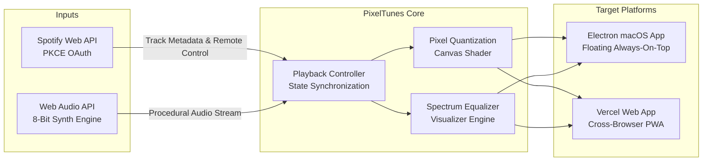

<div align="center">



# 📻 PIXELTUNES

<p><b>Aesthetic retro pixel-art music player with live Spotify Connect integration &amp; 8-bit procedural synth audio.</b></p>

<p>
  <a href="https://pixeltunes.vercel.app"></a>
  <a href="https://github.com/Mxhi-04/Pixeltunes"></a>
  <a href="https://github.com/Mxhi-04/Pixeltunes/stargazers"></a>
  
  <a href="LICENSE"></a>
</p>

<p>
  <a href="https://pixeltunes.vercel.app"><b>🎮 Live Web App</b></a> ·
  <a href="#-quick-start"><b>🚀 Quick Start</b></a> ·
  <a href="#-key-features"><b>✨ Features</b></a> ·
  <a href="#-spotify-connect-setup"><b>🎧 Spotify Setup</b></a> ·
  <a href="#-keyboard-shortcuts"><b>⌨️ Shortcuts</b></a>
</p>

<br>



<p><i>An authentic 90s desktop operating system aesthetic paired with modern Spotify streaming controls and an 8-bit procedural synth engine.</i></p>

</div>

---

## ✨ Why PixelTunes?

- 🎨 **Real-Time Pixel Album Art:** Dynamic canvas shader downsamples and quantizes active Spotify album artwork to authentic retro pixel art on the fly.
- 🎵 **Spotify Connect (Zero Secrets):** Client-side OAuth 2.0 PKCE flow with keychain token persistence and silent auto-refresh — control real Spotify playback across all devices without requiring backend servers.
- 📻 **Procedural 8-Bit Web Audio Radio:** Enjoy lo-fi chip music and responsive equalizer visualizer bars out of the box with zero login required.
- 🖥️ **macOS Desktop & Web Ready:** Run it as a floating, always-on-top desktop companion with background Spotify wake, or open it in any modern web browser.
- 🕹️ **Nostalgic 90s Desktop Aesthetic:** Double-framed retro window geometry (720×410), candy window controls, Google Pixel typography (`Press Start 2P`, `Silkscreen`, `Pixelify Sans`), and custom pixel cursors with click sparks.
- 📋 **Border-Fitted Playlist Queue:** Instant access to your Spotify library and playback queue without leaving the retro window.

---

## 🎨 Visualizer & Scene Gallery

PixelTunes includes a real-time pixel quantization canvas and a curated library of animated retro pixel scenes:

<table>
  <tr>
    <td width="50%" align="center">
      
      <br>
      <sub><b>🪐 Saturn Galaxy</b> — Authentic 8-bit starlight rendering</sub>
    </td>
    <td width="50%" align="center">
      
      <br>
      <sub><b>⭐ Kirby Warpstar</b> — Animated looping nostalgic scene</sub>
    </td>
  </tr>
  <tr>
    <td width="50%" align="center">
      
      <br>
      <sub><b>🔥 Chrono Campfire</b> — Ambient retro campfire lo-fi</sub>
    </td>
    <td width="50%" align="center">
      
      <br>
      <sub><b>🌾 Stardew Valley</b> — Peaceful pixel farm loop</sub>
    </td>
  </tr>
</table>

---

## 🧠 Architecture



---

## 🚀 Quick Start

### 1. Web Application (Vite + React)

```bash
# Clone the repository
git clone https://github.com/Mxhi-04/Pixeltunes.git
cd Pixeltunes

# Install dependencies
npm install

# Start local dev server
npm run dev
```

Visit [`http://localhost:5173`](http://localhost:5173) in your browser.

### 2. Desktop Application (macOS Electron)

```bash
# Live development mode (Vite dev server + Electron with HMR):
npm run electron:dev

# Or production mode (compiles dist bundle and launches native window):
npm run app
```

---

## 🎧 Spotify Connect Setup

PixelTunes uses Spotify's official **OAuth 2.0 with PKCE**, which runs 100% on the client and never requires a Client Secret.

1. Open the [Spotify Developer Dashboard](https://developer.spotify.com/dashboard).
2. Log in and click **"Create app"**:
   - **App Name:** `Pixel Music Player`
   - **App Description:** `Aesthetic Retro Pixel Player`
   - **Redirect URIs:**
     - For Desktop: `http://127.0.0.1:8888/callback`
     - For Web: `http://localhost:5173/` (or your Vercel URL)
   - **Which API/SDKs are you planning to use:** Check **Web API**.
3. Save the app and copy your **Client ID**.
4. In PixelTunes, click **"+ CONNECT SPOTIFY"**, paste your Client ID, and authorize.
5. Play music on any Spotify device (desktop app, mobile, or web) — PixelTunes will mirror and control playback seamlessly!

---

## ⌨️ Keyboard Shortcuts

PixelTunes features full retro hotkey support:

| Key | Action |
| :--- | :--- |
| <kbd>Space</kbd> | Play / Pause playback |
| <kbd>→</kbd> | Skip to next track |
| <kbd>←</kbd> | Return to previous track |
| <kbd>M</kbd> | Toggle audio mute |
| <kbd>S</kbd> | Open Spotify connection settings |

---

## 🎨 Themes

Switch retro color palettes anytime via the top-right menu:

| Theme | Description | Window / Border Palette |
| :--- | :--- | :--- |
| **Pastel Inspo** | The iconic original palette | `#8fa2d4` Periwinkle · `#fec5db` Pink · `#191244` Navy |
| **Bubblegum Dream** | Sweet pastel arcade aesthetic | `#ffb8d1` Bubblegum · `#b3f2dd` Mint · `#361545` Plum |
| **Cyber Vaporwave** | Deep neon synthwave mood | `#472b7a` Purple · `#00f6ff` Cyan · `#ff53a5` Neon Pink |
| **GameBoy Classic** | Authentic 4-shade monochrome olive | `#8bac0f` Light Olive · `#0f380f` Dark Moss |

---

## 🛠️ Tech Stack

- **Core:** [React 18](https://react.dev/), [TypeScript](https://www.typescriptlang.org/), [Vite](https://vitejs.dev/)
- **Styling:** [Tailwind CSS](https://tailwindcss.com/), Google Pixel Fonts (`Press Start 2P`, `Silkscreen`, `Pixelify Sans`)
- **Desktop Runtime:** [Electron 45](https://www.electronjs.org/) with secure Keychain `safeStorage`
- **Audio Engine:** Web Audio API procedural sound synthesizer & spectrum analyser
- **Integration:** Spotify Web API (OAuth 2.0 PKCE, Spotify Connect)

---

## 🗺️ Roadmap

- [x] Spotify Connect remote controls & live state polling
- [x] Real-time album art pixel quantization shader
- [x] Procedural 8-bit synthesizer fallback tracks
- [x] Custom retro pixel cursors & dynamic spark particles
- [x] Border-fitted playlist drawer & liked songs cache
- [x] Electron floating always-on-top desktop companion
- [ ] Global macOS media key integration
- [ ] Additional pixel shader filters (CRT curved barrel distortion, phosphor decay)
- [ ] Standalone `.dmg` installer release pipeline

---

## 📄 License

Distributed under the [MIT License](LICENSE).

<div align="center">

<sub>Crafted with nostalgic care by <a href="https://github.com/Mxhi-04">Mxhi-04</a> · If you like PixelTunes, consider giving it a ⭐</sub>

<br><br>

<a href="#top"><b>▲ Back to Top</b></a>

</div>
