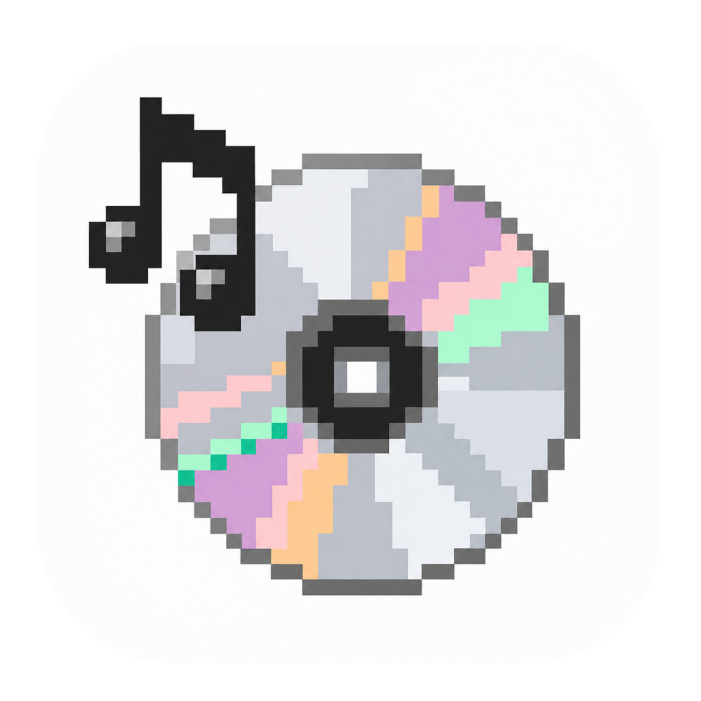
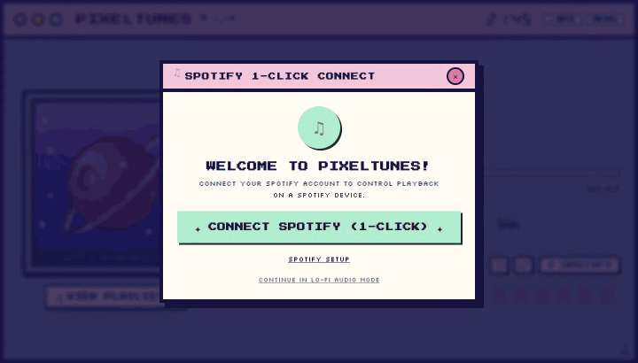
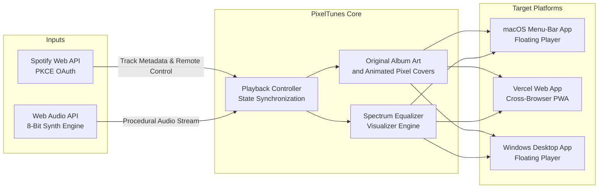

<div align="center">



# PixelTunes

<p><b>A retro desktop player with Spotify Connect controls and a built-in 8-bit lo-fi library.</b></p>

<p>
  <a href="https://pixeltunes.vercel.app"></a>
  <a href="https://github.com/Mxhi-04/Pixeltunes"></a>
  <a href="https://github.com/Mxhi-04/Pixeltunes/stargazers"></a>
  
  <a href="LICENSE"></a>
</p>

<p>
  <a href="https://pixeltunes.vercel.app"><b>🎮 Live Web App</b></a> ·
  <a href="#-quick-start"><b>🚀 Quick Start</b></a> ·
  <a href="#features"><b>✨ Features</b></a> ·
  <a href="#-spotify-connect-setup"><b>🎧 Spotify Setup</b></a> ·
  <a href="#-keyboard-shortcuts"><b>⌨️ Shortcuts</b></a>
</p>

<br>



</div>

---

## Features

- 🎨 **Pixel Scenes & Spotify Artwork:** Pick animated pixel covers, a cassette deck, or original Spotify artwork with a generated pixel-art fallback.
- 🎵 **Spotify Connect (Zero Secrets):** Client-side OAuth 2.0 PKCE flow with keychain token persistence and silent auto-refresh — control real Spotify playback across all devices without requiring backend servers.
- 📻 **Procedural 8-Bit Web Audio Radio:** Enjoy lo-fi chip music and responsive equalizer visualizer bars out of the box with zero login required.
- 🖥️ **Desktop and Web:** Use the macOS menu-bar player, a floating Windows window, or the browser app.
- 🕹️ **Nostalgic 90s Desktop Aesthetic:** Double-framed retro window geometry (720×410), candy window controls, Google Pixel typography (`Press Start 2P`, `Silkscreen`, `Pixelify Sans`), and custom pixel cursors with click sparks.
- 📋 **Spotify Library:** The drawer opens on your playlists. Load more playlists, play one on Spotify, or switch to **Liked Songs** or **Up Next**.

---

## 🧠 Architecture



---

## 🚀 Quick Start

### 1. Web Application (Vite + React)

```bash
# Clone the repository
git clone https://github.com/Mxhi-04/Pixeltunes.git
cd Pixeltunes

# Install dependencies
npm install

# Start local dev server
npm run dev
```

Visit [`http://127.0.0.1:5173`](http://127.0.0.1:5173) in your browser.

### 2. Desktop Application (macOS and Windows)

```bash
# Live development mode (Vite dev server + Electron with HMR):
npm run electron:dev

# Or production mode (compiles dist bundle and launches native window):
npm run app
```


On macOS, click the disc and note icon in the menu bar to show or hide the player. Closing the player window keeps playback running. Right-click the icon to choose a window size, toggle **Keep Player on Top**, open Spotify, or quit.

To build a standalone macOS app for your Mac’s architecture, run `npm run package:mac`. Open `release/PixelTunes-darwin-<arch>/PixelTunes.app` or drag it into Applications. The build uses a local ad-hoc signature.

On x64 Windows, run `npm run package:windows` to build the portable app. Run `PixelTunes.exe` inside `release/PixelTunes-win32-x64` and keep it with the accompanying files. The portable build is unsigned.

---

## 🎧 Spotify Connect Setup

When a desktop build has an approved Spotify app configured, click **Connect Spotify** and complete Spotify’s consent screen in your browser. PixelTunes comes back to the foreground and remembers the connection. Playback controls require Spotify Premium and a Spotify Connect device.

### Local development

Development Mode requires a Premium app owner and dashboard access for each listener.

1. Create a Web API app in the [Spotify Developer Dashboard](https://developer.spotify.com/dashboard).
2. Register the exact redirect URI for each environment you use.
   - Electron uses `http://127.0.0.1:8888/callback`.
   - Local web development uses `http://127.0.0.1:5173/callback`.
   - Hosted web uses `https://your-domain.example/callback`.
3. Set `VITE_SPOTIFY_CLIENT_ID` to the app’s Client ID. For a local run, export it before running `npm run dev`, `npm run app`, or `npm run electron:dev`. Set it in your hosting environment before building the web app.
4. In the desktop app, you can also open **Spotify Setup → Use your own Spotify Client ID** and authorize it in the browser. PixelTunes remembers the Client ID for future sign-ins. Open Spotify on your playback device to use the remote controls.

If Spotify returns HTTP 403 after consent, the app owner may need to allow your account in **Users Management**. In the installed macOS app you can also open **Spotify Setup → Use your own Spotify Client ID**, enter your app’s Client ID, and connect again. The macOS menu bar’s **Open Spotify** command opens the installed client or falls back to the web player.

Paste a track, album, or playlist URL or URI in **Spotify → Spotify link or URI**. You can open a valid link in Spotify as a guest. When connected, use **Play Link** or **Add to Queue** for a track. **View Playlist → Playlists** shows the playlists Spotify returns for your account. Click a playlist to play it, or use its arrow to open it in Spotify.

See [Spotify redirect URI requirements](https://developer.spotify.com/documentation/web-api/concepts/redirect_uri) and [Spotify quota modes](https://developer.spotify.com/documentation/web-api/concepts/quota-modes).

### Release automation

GitHub Actions tests macOS and Windows. The manual **Release PixelTunes Desktop** workflow needs a shared app with Spotify’s approval for public access. The repo maintainer sets the `SPOTIFY_CLIENT_ID` and `SPOTIFY_PUBLIC_ACCESS_APPROVED` repository variables, then confirms a live sign-in and playback check on both platforms. After the builds and tests pass, `github-actions[bot]` commits the version bump, tags it, and publishes the macOS and Windows archives.

---

## ⌨️ Keyboard Shortcuts

PixelTunes features full retro hotkey support:

| Key | Action |
| :--- | :--- |
| <kbd>Space</kbd> | Play / Pause playback |
| <kbd>→</kbd> | Skip to next track |
| <kbd>←</kbd> | Return to previous track |
| <kbd>M</kbd> | Toggle audio mute |
| <kbd>S</kbd> | Open Spotify connection settings |

---

## 🎨 Themes

Switch palettes in the top-right menu. The app remembers your palette, art mode, resolution, layout, animation, and CRT preferences.

| Theme | Description | Window / Border Palette |
| :--- | :--- | :--- |
| **Pastel Inspo** | The iconic original palette | `#8fa2d4` Periwinkle · `#fec5db` Pink · `#191244` Navy |
| **Bubblegum Dream** | Sweet pastel arcade aesthetic | `#ffb8d1` Bubblegum · `#b3f2dd` Mint · `#361545` Plum |
| **Cyber Vaporwave** | Deep neon synthwave mood | `#472b7a` Purple · `#00f6ff` Cyan · `#ff53a5` Neon Pink |
| **GameBoy Classic** | Authentic 4-shade monochrome olive | `#8bac0f` Light Olive · `#0f380f` Dark Moss |
| **Moonlight Arcade** | Blue-lit night arcade | `#242f52` Navy · `#b6cbff` Moonlight |
| **Amber Terminal** | Warm phosphor display | `#43281f` Brown · `#ffc16d` Amber |
| **Mint Circuit** | Bright mint hardware | `#abe1cf` Mint · `#123b30` Forest |

---

## 🛠️ Tech Stack

- **Core:** [React 18](https://react.dev/), [TypeScript](https://www.typescriptlang.org/), [Vite](https://vitejs.dev/)
- **Styling:** [Tailwind CSS](https://tailwindcss.com/), Google Pixel Fonts (`Press Start 2P`, `Silkscreen`, `Pixelify Sans`)
- **Desktop Runtime:** [Electron 45](https://www.electronjs.org/) with secure Keychain `safeStorage`
- **Audio Engine:** Web Audio API procedural sound synthesizer & spectrum analyser
- **Integration:** Spotify Web API (OAuth 2.0 PKCE, Spotify Connect)

---

## Testing

Run `npx playwright install chromium` and then `npm test`. The suite builds the production app and exercises browser playback, settings, Spotify link handling, and OAuth. The Electron test launches an isolated profile and uses a mocked Spotify account. Quit any running PixelTunes app first to free its Spotify callback port.

Install Firefox and WebKit with `npx playwright install firefox webkit`, then run `PIXELTUNES_CROSS_BROWSER=1 npm test` to include both browser engines.

If Firefox reports a missing profile on macOS, give the test process isolated Firefox app-data directories. [Playwright issue #42768](https://github.com/microsoft/playwright/issues/42768)

```bash
browser_data=$(mktemp -d)
mkdir -p "$browser_data/firefox" "$browser_data/firefox-local"
MOZ_APP_DATA="$browser_data/firefox" MOZ_LOCAL_APP_DATA="$browser_data/firefox-local" PIXELTUNES_CROSS_BROWSER=1 npm test
```

---

## 🗺️ Roadmap

- [x] Spotify Connect remote controls & live state polling
- [x] Original Spotify artwork and generated pixel scenes
- [x] Procedural 8-bit synthesizer fallback tracks
- [x] Custom retro pixel cursors & dynamic spark particles
- [x] Liked Songs, Spotify queue, and built-in lo-fi library
- [x] Electron floating always-on-top desktop companion
- [ ] Global macOS media key integration
- [ ] Additional pixel shader filters (CRT curved barrel distortion, phosphor decay)
- [ ] Standalone `.dmg` installer release pipeline

---

## 📄 License

Distributed under the [MIT License](LICENSE).

<div align="center">

<sub>Crafted with nostalgic care by <a href="https://github.com/Mxhi-04">Mxhi-04</a> · If you like PixelTunes, consider giving it a ⭐</sub>

<br><br>

<a href="#top"><b>▲ Back to Top</b></a>

</div>
